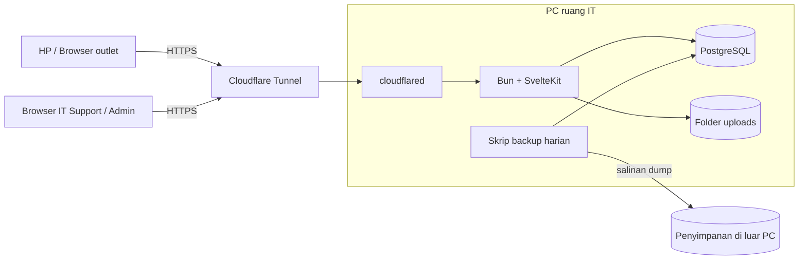
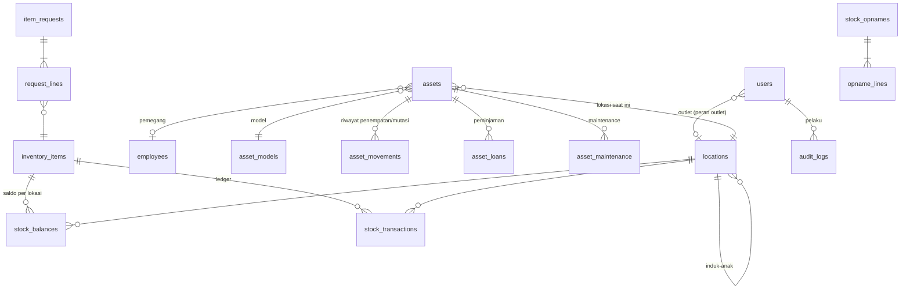

# Arsitektur: IT Asset & Inventory Management System

**Versi:** 1.0 (draft) · **Dasar:** PRD v1.0 · **Skala:** ±100 pengguna/hari, satu developer, anggaran minimal

---

## 1. Ringkasan keputusan

| Area             | Keputusan                                                                |
| ---------------- | ------------------------------------------------------------------------ |
| Gaya arsitektur  | **Monolit modular** (satu aplikasi, satu database). Tanpa microservices. |
| Runtime          | Bun                                                                      |
| Framework        | SvelteKit (SSR + form actions), adapter resmi `@sveltejs/adapter-bun`    |
| Database         | PostgreSQL                                                               |
| ORM & migrasi    | Drizzle ORM + drizzle-kit                                                |
| Hosting awal     | PC di ruang IT (menyala 24 jam), diakses publik lewat Cloudflare Tunnel  |
| Hosting lanjutan | VPS kecil (jalur pindah sudah disiapkan, lihat bagian 11)                |
| Auth             | Sesi berbasis cookie, tabel `sessions` di PostgreSQL                     |
| Otorisasi        | Role + cakupan outlet, ditegakkan di lapisan service                     |
| File foto        | Disk lokal (`/data/uploads`), dilayani lewat route yang terautentikasi   |
| Backup           | `pg_dump` harian, disalin ke luar PC, pemulihan diuji berkala            |

**Prinsip:**

1. Satu tempat untuk setiap aturan bisnis (lapisan _service_), bukan tersebar di halaman.
2. Setiap perubahan data penting terjadi dalam **satu transaksi** bersama catatan audit-nya.
3. Data transaksi tidak pernah dihapus permanen (sesuai PRD aturan #8 dan #12).
4. Mobile-first: halaman server-rendered ringan, form bekerja tanpa JavaScript (progressive enhancement).
5. Pilih yang membosankan dan mudah dipelihara sendirian.

---

## 2. Gambaran sistem



Hanya `cloudflared` yang berhubungan dengan internet. Port aplikasi dan PostgreSQL **tidak dibuka** di router.

---

## 3. Struktur proyek

```
inventory/
├─ src/
│  ├─ hooks.server.ts            # baca sesi → event.locals.user, header keamanan
│  ├─ lib/
│  │  ├─ components/             # komponen UI (button, input, badge, ...)
│  │  ├─ styles/tokens.css       # token dari design system v1
│  │  └─ server/                 # hanya bisa diimpor kode server ($lib/server)
│  │     ├─ db/
│  │     │  ├─ index.ts          # koneksi Drizzle
│  │     │  └─ schema/           # satu file per domain (assets.ts, stock.ts, ...)
│  │     ├─ auth/
│  │     │  ├─ session.ts        # buat/validasi/hapus sesi
│  │     │  └─ permissions.ts    # matriks hak akses + cakupan outlet
│  │     ├─ services/            # aturan bisnis: assets.ts, stock.ts, requests.ts, ...
│  │     ├─ audit.ts             # writeAudit(tx, ...)
│  │     └─ errors.ts            # DomainError (kode + pesan untuk pengguna)
│  └─ routes/
│     ├─ (auth)/login/
│     ├─ (app)/                  # +layout.server.ts: wajib login
│     │  ├─ dashboard/
│     │  ├─ assets/
│     │  ├─ inventory/
│     │  ├─ stock/               # stock in / out / transfer
│     │  ├─ requests/
│     │  ├─ reports/             # termasuk endpoint export CSV/Excel
│     │  └─ admin/               # pengguna, master data, audit log
│     └─ healthz/+server.ts      # cek hidup + cek koneksi DB
├─ drizzle/                      # file migrasi (masuk Git)
├─ drizzle.config.ts
├─ scripts/                      # backup.sh, restore.md, deploy.sh
└─ .env.example
```

---

## 4. Lapisan aplikasi

```
Route (+page.server.ts: load / actions)
   └─ memanggil → Service (aturan bisnis + otorisasi + transaksi)
                     └─ memanggil → Drizzle (query)
                                       └─ PostgreSQL
```

Aturan yang dijaga ketat:

- **Route tidak menulis query sendiri.** Route hanya memvalidasi input (mis. Zod/Valibot), memanggil service, dan menerjemahkan hasil/error ke tampilan.
- **Service menerima `user` dan memeriksa izin di dalamnya.** Dengan begitu tidak ada jalur yang lupa memeriksa hak akses.
- **Service yang mengubah data membuka transaksi** dan menulis audit di transaksi yang sama.
- **`DomainError`** dipakai untuk kegagalan yang bisa dijelaskan ke pengguna (stok tidak cukup, kode aset sudah dipakai). Error lain dicatat ke log dan ditampilkan sebagai pesan umum.
- Tidak ada REST API terpisah. Cukup form actions dan `load`. Endpoint khusus hanya untuk export file dan `/healthz`.

---

## 5. Autentikasi dan otorisasi

### 5.1 Sesi

- Login dengan email/username + password. Password di-hash dengan argon2id (`Bun.password`).
- Token sesi acak disimpan di cookie (`httpOnly`, `secure`, `sameSite=lax`). Di database hanya disimpan **hash** token.
- Masa berlaku awal: 7 hari, diperpanjang saat aktif. Admin dapat mencabut sesi pengguna.
- Pembatasan percobaan login (per akun dan per IP). Satu proses saja, jadi penghitung di memori cukup untuk v1.
- Perlindungan CSRF: pengecekan origin bawaan SvelteKit untuk form actions tetap aktif.

### 5.2 Hak akses

Matriks PRD (bagian 2.2) diterjemahkan menjadi izin eksplisit per peran:

```ts
// $lib/server/auth/permissions.ts (sketsa)
type Role = 'admin' | 'support' | 'outlet';

const PERMISSIONS: Record<Role, string[]> = {
	admin: ['*'],
	support: [
		'asset:read',
		'asset:write',
		'asset:mutate',
		'inventory:read',
		'inventory:write',
		'stock:in',
		'stock:out',
		'request:process',
		'loan:write',
		'maintenance:write',
		'opname:write',
		'disposal:write',
		'report:read:all',
		'audit:read:limited',
		'masterdata:write:limited'
	],
	outlet: [
		'asset:read:own',
		'inventory:read:own',
		'request:create',
		'request:read:own',
		'maintenance:report',
		'opname:assist',
		'report:read:own',
		'mutation:read:own'
	]
};
```

### 5.3 Cakupan outlet

- Setiap lokasi menyimpan `outlet_id` (outlet induk atau Head Office), sehingga semua area di dalamnya ikut tercakup tanpa query rekursif.
- Pengguna peran `outlet` punya `outlet_id` wajib. Helper `scopeToUser(user)` menambahkan filter `outlet_id` ke setiap query daftar/laporan dan dipakai oleh **semua** service.
- Pengambilan satu record (detail) juga diperiksa: record dari outlet lain dijawab seperti "tidak ditemukan".

---

## 6. Model data

### 6.1 Entitas inti



Master data lain (kategori, brand, unit, supplier, departemen) berupa tabel sederhana yang dirujuk lewat foreign key.

### 6.2 Aturan desain data

- **Aset dan inventory dipisah** (PRD aturan #3): aset individual di `assets`, barang berjumlah di `inventory_items`.
- **Ledger stok bersifat append-only.** `stock_transactions` hanya ditambah. Koreksi dilakukan dengan transaksi _adjustment_, bukan mengubah baris lama.
- **`stock_balances`** (item + lokasi → qty) adalah saldo yang selalu diperbarui bersama ledger dalam satu transaksi, dengan `CHECK (qty >= 0)`.
- **Riwayat aset** (`asset_movements`) mencatat penempatan dan mutasi: dari/ke lokasi, dari/ke pemegang, pelaku, waktu. Lokasi saat ini di `assets` adalah salinan dari catatan terakhir.
- **Tidak ada hard delete** untuk data transaksional. Aset yang dihapus diberi status `Disposed` dan riwayatnya tetap ada. Master data yang sudah dipakai dinonaktifkan (`is_active = false`).
- **Snapshot nama pada transaksi** yang perlu bertahan saat master data berubah (PRD aturan #8), misalnya nama lokasi atau pemegang pada baris mutasi.
- `asset_code` dan `item_code` **unik**. `serial_number` boleh kosong, unik hanya jika terisi (partial unique index).
- Status aset dan status request memakai **enum PostgreSQL** (bagian dari logika bisnis); kategori dan kondisi mengikuti master data.
- Semua waktu disimpan sebagai `timestamptz` (UTC) dan ditampilkan dalam zona waktu WIB secara default.

### 6.3 Contoh skema (Drizzle)

```ts
export const stockBalances = pgTable(
	'stock_balances',
	{
		itemId: integer('item_id')
			.notNull()
			.references(() => inventoryItems.id),
		locationId: integer('location_id')
			.notNull()
			.references(() => locations.id),
		qty: integer('qty').notNull().default(0)
	},
	(t) => [
		primaryKey({ columns: [t.itemId, t.locationId] }),
		check('qty_non_negative', sql`${t.qty} >= 0`)
	]
);
```

(Sesuaikan sintaks dengan versi Drizzle yang terpasang.)

---

## 7. Konsistensi, transaksi, dan audit

### 7.1 Stock out yang aman

Pengurangan stok memakai satu `UPDATE` bersyarat, sehingga dua permintaan bersamaan tidak membuat stok negatif dan tidak perlu kunci manual:

```ts
await db.transaction(async (tx) => {
	const updated = await tx
		.update(stockBalances)
		.set({ qty: sql`${stockBalances.qty} - ${qty}` })
		.where(
			and(
				eq(stockBalances.itemId, itemId),
				eq(stockBalances.locationId, locationId),
				gte(stockBalances.qty, qty)
			)
		)
		.returning();
	if (updated.length === 0) throw new DomainError('STOK_TIDAK_CUKUP');

	await tx.insert(stockTransactions).values({/* jenis: 'out', qty, pelaku, referensi request */});
	await writeAudit(tx, user, { module: 'stock', action: 'stock_out', recordId, before, after });
});
```

### 7.2 Audit log

- Ditulis oleh `writeAudit(tx, ...)` **di dalam transaksi yang sama**, jadi tidak mungkin ada perubahan tanpa catatan (atau sebaliknya).
- Kolom: user, action, module, record id, nilai sebelum, nilai sesudah (JSONB), waktu.
- **Tidak bisa diubah/dihapus lewat aplikasi:** aplikasi berjalan dengan role database yang hanya punya `INSERT` dan `SELECT` pada `audit_logs` (`REVOKE UPDATE, DELETE`). Migrasi memakai role terpisah.
- Aktivitas wajib dicatat mengikuti PRD bagian 3.13.

### 7.3 Pencegahan kirim ganda

Form yang membuat transaksi (stock out, mutasi, request) membawa token sekali pakai, dan tombol dinonaktifkan saat proses berjalan. Ini penting untuk jaringan HP yang lambat.

---

## 8. File foto

- Disimpan di `/data/uploads/<tahun>/<bulan>/<uuid>.<ext>`, path-nya disimpan di database.
- Validasi tipe dan ukuran (mis. maks 5 MB), ubah ukuran ke lebar wajar sebelum disimpan agar hemat disk dan kuota HP.
- Dilayani lewat route yang memeriksa login dan cakupan outlet, bukan folder publik.
- Folder ini ikut dibackup. Jika kelak berpindah ke object storage (S3/R2), hanya lapisan penyimpanan yang diganti.

---

## 9. Laporan dan impor/ekspor

- Daftar memakai **pagination di server** dan indeks pada kolom filter (lokasi, status, kategori, tanggal).
- Export CSV dikirim sebagai stream. Export Excel memakai library (pilihan terbuka, lihat bagian 14).
- Impor Excel/CSV untuk data awal (PRD aturan #11): halaman admin atau skrip, dengan **tahap pratinjau dan validasi** sebelum data benar-benar ditulis, serta laporan baris yang gagal.
- Dashboard memakai query agregat langsung. Pada skala ini belum perlu cache atau tabel ringkasan.

---

## 10. Observability

- Log terstruktur ke file/stdout (level, user id, request id) dengan rotasi.
- `/healthz` mengecek aplikasi dan koneksi database. Pantau dari luar dengan layanan uptime gratis.
- Error tak terduga dicatat lengkap di log, sedangkan pengguna hanya melihat pesan umum dan kode rujukan.

---

## 11. Deployment

### 11.1 Di PC ruang IT

**PostgreSQL native Windows** menjadi pilihan utama; Docker tidak diperlukan di PC ini.

- Service: `postgresql-x64-18`, start automatic, data di `C:\Program Files\PostgreSQL\18\data`.
- Database `inventory`, owner `inventory_owner`, role aplikasi `inventory_app` dengan hak terbatas.
- Untuk produksi, service wajib diikat ke localhost dan memakai autentikasi `scram-sha-256`:

```conf
# postgresql.conf
listen_addresses = 'localhost'
port = 5432
```

```conf
# pg_hba.conf — contoh untuk role aplikasi
host    inventory    inventory_owner    127.0.0.1/32    scram-sha-256
host    inventory    inventory_app      127.0.0.1/32    scram-sha-256
```

- Docker Compose tetap tersedia sebagai opsi untuk Linux/VPS, bukan kebutuhan di PC ini.
- **Aplikasi** berjalan sebagai service OS dengan restart otomatis (systemd di Linux; Task Scheduler/NSSM di Windows). Konfigurasi lewat `.env`/environment.
- **cloudflared** berjalan sebagai service, mengarahkan domain ke port lokal aplikasi.
- **Perangkat keras:** UPS, BIOS "nyala otomatis saat listrik pulih", sleep dimatikan, jam update OS diatur di luar jam kerja, SSD dipantau kesehatannya.

### 11.2 Alur deploy (dari laptop ke PC)

```
git pull
bun install --frozen-lockfile
bun run build
bun run db:migrate        # memakai DATABASE_URL_MIGRATE
# restart service aplikasi
```

Gunakan `bun run db:migrate` (file migrasi di Git) untuk produksi, jangan `drizzle-kit push`.

### 11.3 Jalur pindah ke VPS

Konfigurasi ada di environment, data ada di dua tempat (data directory PostgreSQL dan `/data/uploads`). Pindah = `pg_dump` + salin uploads + jalankan PostgreSQL/aplikasi di VPS + ubah target tunnel atau DNS.

### 11.4 Catatan teknis Bun + Drizzle

Drizzle mendukung driver `drizzle-orm/bun-sql` (klien PostgreSQL bawaan Bun). Jika ditemukan masalah di Bun versi tertentu, driver alternatif `postgres` (postgres-js) dapat dipakai tanpa mengubah skema atau query, karena hanya lapisan koneksi di `db/index.ts` yang berganti.

---

## 12. Backup dan pemulihan

| Item      | Rencana                                                                 |
| --------- | ----------------------------------------------------------------------- |
| Database  | `pg_dump -Fc` setiap hari pada jam sepi                                 |
| Foto      | Salin folder `/data/uploads` (inkremental)                              |
| Lokasi    | Minimal satu salinan **di luar PC** (cloud storage atau perangkat lain) |
| Retensi   | 7 harian + 4 mingguan + 3 bulanan                                       |
| Uji pulih | Pulihkan ke database kosong sebelum go-live, lalu tiap kuartal          |
| Target    | RPO ±24 jam, RTO beberapa jam (PC tunggal)                              |

```powershell
# scripts/backup.ps1 (sketsa)
$ts = Get-Date -Format 'yyyy-MM-dd'
$out = "D:\backups\inventory-$ts.dump"
& 'C:\Program Files\PostgreSQL\18\bin\pg_dump.exe' `
  -h 127.0.0.1 -U inventory_owner -Fc -f $out inventory
# Gunakan .pgpass/PGPASSFILE agar password tidak ditulis di command line.
# Lalu salin ke luar PC (rclone/robocopy), hapus yang melewati retensi.
```

Jika kehilangan data 24 jam nanti dianggap terlalu besar, tingkatkan dengan arsip WAL atau backup lebih sering.

---

## 13. Keamanan (daftar periksa v1)

- [ ] HTTPS hanya lewat Cloudflare; tidak ada port terbuka di router
- [ ] Hash password argon2id; batas percobaan login
- [ ] Cookie sesi `httpOnly` + `secure` + `sameSite`
- [ ] Otorisasi di service, bukan hanya menyembunyikan menu
- [ ] Filter outlet pada setiap query dan detail record
- [ ] Role database aplikasi dibatasi; `audit_logs` hanya INSERT/SELECT
- [ ] Validasi semua input di server; batas ukuran dan tipe file upload
- [ ] Header keamanan (CSP, `X-Content-Type-Options`, `Referrer-Policy`)
- [ ] Rahasia (`.env`, password DB) tidak masuk Git
- [ ] Akun admin awal wajib ganti password; admin dapat mencabut sesi
- [ ] Akses fisik ke PC dibatasi; disk dienkripsi jika memungkinkan

---

## 14. Keputusan terbuka

| Topik          | Opsi                                         | Catatan                                                                       |
| -------------- | -------------------------------------------- | ----------------------------------------------------------------------------- |
| Auth           | Implementasi sendiri (sederhana) vs library  | Implementasi sendiri cukup untuk 3 peran; pastikan sudah diuji                |
| Validasi       | Zod vs Valibot                               | Valibot lebih ringan; keduanya cocok                                          |
| Export Excel   | Library seperti ExcelJS                      | Uji pemakaian memori untuk laporan besar                                      |
| Status/kondisi | Enum vs master data penuh                    | Enum untuk status (logika), master data untuk kondisi bila perlu diubah admin |
| Komponen UI    | Tulis sendiri dari token vs library headless | Tulis sendiri lebih ringan untuk ±10 komponen                                 |
| Notifikasi     | Tanpa notifikasi di v1                       | Stok minimum dan jatuh tempo cukup tampil di dashboard                        |

---

## 15. Tahapan dan kriteria selesai arsitektur

Mengikuti PRD bagian 7.

**Tahap 1 (P0):** auth + peran, master data, aset, inventory, penerimaan dan stock in/out, lokasi dan penempatan, dashboard dan laporan dasar, audit log dasar, impor data awal.
**Tahap 2 (P1):** mutasi aset, peminjaman, maintenance, request outlet.
**Tahap 3:** stock opname, disposal, laporan lanjutan, penguatan audit log.

Sebelum dipakai sungguhan, pastikan:

- [ ] Hak akses tiap peran diuji dengan akun nyata (terutama isolasi antar outlet)
- [ ] Stock out bersamaan tidak membuat saldo negatif (diuji dengan dua permintaan paralel)
- [ ] Setiap perubahan aset/stok menghasilkan baris audit
- [ ] Backup berjalan otomatis dan **pemulihan berhasil diuji**
- [ ] Aplikasi hidup kembali sendiri setelah PC dimatikan paksa
- [ ] Dapat dibuka dan dipakai nyaman di HP dari jaringan luar kantor

---

## 16. Risiko utama

| Risiko                        | Dampak                      | Mitigasi                                                       |
| ----------------------------- | --------------------------- | -------------------------------------------------------------- |
| PC tunggal mati atau rusak    | Aplikasi tidak bisa diakses | UPS, backup di luar PC, siap pindah ke VPS (bagian 11.3)       |
| Data di PC rusak atau hilang  | Kehilangan data             | Backup harian + uji pulih                                      |
| Salah hak akses antar outlet  | Kebocoran data              | Filter outlet terpusat + pengujian per peran                   |
| Developer tunggal berhalangan | Pemeliharaan terhenti       | Dokumentasi ini, skrip deploy/backup tertulis, stack sederhana |
| Beban melebihi perkiraan      | Lambat                      | Indeks, pagination; pindah ke VPS bila perlu                   |
